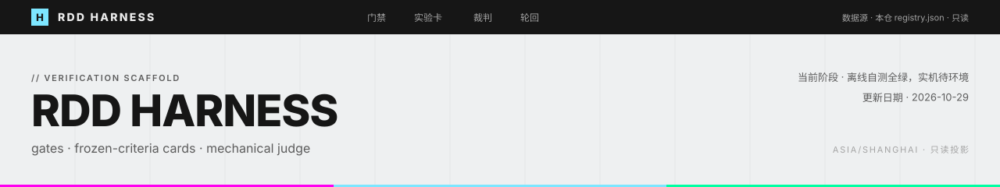
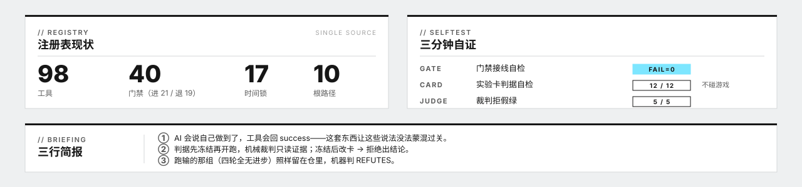

<div align="center">



</div>



> **数据源**：本仓 `registry.json` 与 `bin/` 的真实自测输出 —— 只读投影。
> **更新日期**：2026-10-29（Asia/Shanghai）

---

## // Overview · 这是什么

给「AI 在 Minecraft 里自主干活」配的一层**工程脚手架**。

宿主 AI 会说自己做到了，工具会回 `success: true`，但世界可能什么都没变——这套东西存在的唯一目的，就是让这些说法**没法蒙混过关**。

| 部件 | 作用 | 入口 |
|---|---|---|
| `registry.json` | 单一真源：98 工具、40 门禁（进 21 / 退 19）、10 条根路径、17 条时间锁 | `bin/harness-gate.js registry` |
| **门禁** | 进游戏前 `preflight` / 退游戏后 `postflight`；`selftest` 自检接线 | `bin/harness-gate.js selftest` |
| **实验卡** | 可证伪主张 + 成功/失败双阈值 + 正负对照 + 冻结 hash + 原始数据复算 | `bin/exp-card.js new/validate/freeze/conclude` |
| **运行器** | 复制母版世界 → 起停游戏 → 派活 → 观测 → 受控复位 → 归档 | `bin/exp-runner.js run --label x --minutes N` |
| **裁判** | 只读证据出裁决，不认口头结论（离线自测 5/5 拒三种假绿） | `bin/exp-judge.js <runDir>` |
| **轮回** | 连跑 N 轮、轮末简报带进下一轮、机械判定 improved | `bin/exp-cycle.js run --prefix learn --rounds 4` |
| **观测器** | 标准开源 mineflayer@4.39.0（无 fork） | `bin/mf-observer.js smoke/eval` |

**近期目标**：让每一次「变强了」的结论都能从原始数据复算出来，**包括那些跑输的**。
**远期愿景**：让这套判定方式脱离 Minecraft。本阶段不展开。

---

## // Status · 当前阶段

| 项目 | 状态 | 说明 |
|---|---|---|
| 门禁（preflight 21 / postflight 19） | <kbd>✅ 已实现</kbd> | `selftest` FAIL=0；退出码 0 全过 / 1 有 BLOCK / 3 环境错 |
| 实验卡（冻结判据 / 正负对照） | <kbd>✅ 已实现</kbd> | 离线自测 12/12 |
| 机械裁判 | <kbd>✅ 已实现</kbd> | 离线自测 5/5，拒三种假绿 |
| 无人值守轮回 | <kbd>✅ 已实现</kbd> | 连跑 N 轮，机械判定 improved |
| 观测器 | <kbd>✅ 已实现</kbd> | 标准开源 mineflayer@4.39.0，无 fork |
| 实机轮回 | <kbd>🟡 待环境</kbd> | 需要 Minecraft 实例；本仓不含实例与 mods |

---

## // Read · 从这里读

- **<kbd>自证</kbd> 三分钟自证** —— 先跑三条离线自测，证明「裁判不撒谎」，再谈跑实验。不碰游戏、不需要任何 API key → [快速开始](#快速开始三分钟自证)
- **<kbd>核心</kbd> 实验台怎么保证不说谎** —— 这套东西的核心。想看设计态度，直接跳这节 → [实验台](#实验台怎么保证不说谎)
- **<kbd>实验</kbd> 真实实验长什么样** —— 我们跑过的学习轮回，**包括那组四轮全无进步的** → [真实实验](#真实实验长什么样)
- **<kbd>边界</kbd> 诚实的边界** —— 我们不主张什么。比上面那节更重要 → [边界](#诚实的边界)
- **<kbd>部署</kbd> 部署到新机器** —— 618 行实测迁移记录，约 40 条坑 → [部署](#部署到新机器)
- **<kbd>内部</kbd> 内部工作台说明** —— 目录逐项、路由铁律、门禁逐项判据 → [README-内部工作台.md](README-内部工作台.md)

---

## // Boundary · 独立建设边界

> 「**先证明裁判不撒谎，再谈跑实验。**」（本项目的第一条铁律）

- 本仓**只是脚手架**。Minecraft 实例、mods、存档、JDK/Gradle/Node、模型 API 都不在仓里，按部署文档自建。
- **任何密钥都不入库。** `multimodel/` 只含 OpenRouter 免费模型的定价信息，不含 key。
- 本仓**不追求跑出漂亮数字**。判据先冻结、数据赢——这两条是唯一不可让步的部分。
- **不主张「越玩越聪明」。** 现有实验是小样本 pilot，只能看方向。
- 三态纪律：<kbd>✅ 已完成</kbd> ／ <kbd>🟡 已写码未实测</kbd> ／ <kbd>⬜ 计划中</kbd>。**编译成功 ≠ 已完成。**

---

## 快速开始（三分钟自证）

```powershell
node bin/harness-gate.js selftest   # 门禁接线全 ✔（FAIL=0）
node bin/exp-card.js selftest       # 12/12（判据矛盾/无种子/缺理由/样本不足/改卡/claim 矛盾 必拒）
node bin/exp-judge.js --selftest    # 5/5（加载错/缺裁剪/只回成功无产物 必拒）
```

这三条不碰游戏、不需要任何 API key——先证明「裁判不撒谎」，再谈跑实验。

---

## 实验台怎么保证不说谎

一套实验要过四道关，任何一道过不去，结论就不成立：

| # | 关卡 | 规则 |
|---|---|---|
| 1 | **判据先冻结** | 开跑之前把「什么算成功、什么算失败」写死，连同 git commit 冻成 hash。跑完再改判据 → 拒绝出结论 |
| 2 | **成功与失败双阈值** | 不能只写「≥N 就成功」，必须同时写「≤M 就失败」。中间地带判 INCONCLUSIVE，**不制造显著性** |
| 3 | **正负对照** | 正向对照证明实验能跑出成功（不是环境坏了），负向对照证明裁判能判失败（不是永远给绿灯） |
| 4 | **只从原始数据复算** | 裁判读证据文件，不读总结、不读聊天记录。样本不足、字段缺失 → INCONCLUSIVE |

还有一条：**冻结之后改卡，拒绝出结论**。口头 claim 与数据矛盾时，**数据赢**。

---

## 真实实验长什么样

我们跑了四组无人值守学习轮回，每组 3–4 轮，每轮约 900–2033 秒，记录六项指标：最远阶段、阶段耗时、死亡、卡点、墙钟、经验变化。

「变强了没有」只看**最远阶段 + 同阶段耗时**，不看聊天措辞。

| 组 | 轮数 | 结果 | 机械判定 |
|---|---|---|---|
| **learn** | 4 | 第 2 轮冲到钻石套，第 4 轮冲到铁器，其余两轮石器 | <kbd>2 轮更强</kbd> |
| **clean2** | 4 | **四轮全停在石器**，无死亡 | <kbd>REFUTES</kbd> 没有轮次强于第 1 轮 |
| **auto** | 3 | 第 1 轮木器（死 1 次），第 2/3 轮石器 | <kbd>2 轮更强</kbd> |

**clean2 那组是关键。** 四轮跑完什么都没长进，机器判了 REFUTES，这条负面结论原样留在仓库里。如果删掉它，我们就变成在自证；留着，才叫实验。

每组原始数据都在 `experiments/journal/`，判决在 `experiments/cards/`。每一份都带同一句告示：**小样本 pilot，只能看方向，不能下「越玩越聪明」结论。**

---

## 跑一次真实轮回（需要 Minecraft 实例）

```powershell
node bin/exp-card.js new exp-demo --title "两轮独立冒烟都通过"
# 编辑 experiments/cards/exp-demo.json：claim / 阈值 / 对照 / 数据源
node bin/exp-card.js validate experiments/cards/exp-demo.json
node bin/exp-card.js freeze experiments/cards/exp-demo.json --commit <git sha> --apply
node bin/exp-cycle.js run --prefix demo --rounds 4 --minutes 25 --zero-start --goal-file <开场任务.txt>
node bin/exp-card.js conclude experiments/cards/exp-demo.json
```

---

## 部署到新机器

看 `package/README-自动harness包-20261027.md` + `package/74-新机安装与迁移指南-20261019.md`
（618 行实测迁移记录：0–8 阶段顺序、约 40 条坑的症状→根因→修法、验收清单）。

---

## 诚实的边界

- 本仓只是「脚手架」：Minecraft 实例、mods、存档、JDK/Gradle/Node、模型 API 都不在仓里，按部署文档自建。
- `multimodel/` 是多模型适配层（OpenRouter 免费表只含定价信息，无 key）；任何密钥都不入库。
- 门禁里的路径真源在 `registry.json` 的 `roots`，换机改那 10 条即可。
- 实验结论的样本量都很小（pilot），只能看方向；我们不夸大「越玩越聪明」。
- 时间锁是「这个坑我们决定这一轮不修，但写了到期日」的账本——**「不修」也是一种要记账的决定**。

---

## // License

MIT。用的时候请保留「判据先冻结、数据赢」这两条精神——那是这套东西唯一不可让步的部分。
